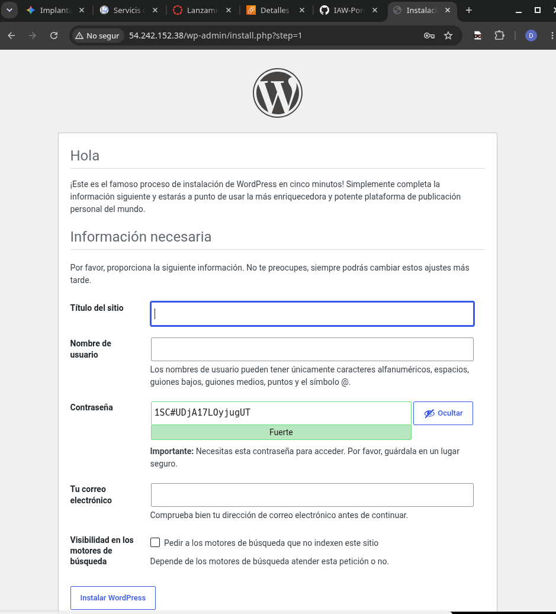
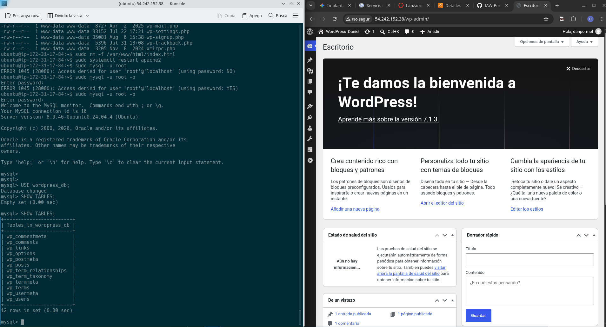
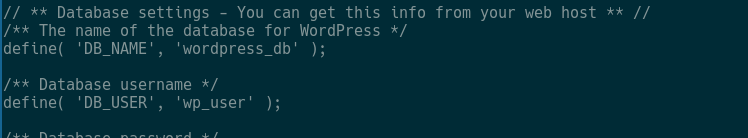
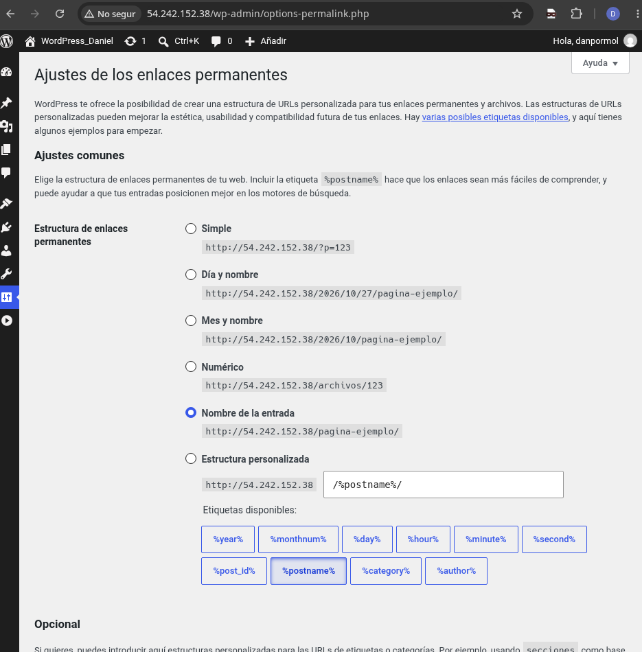

 # Pràctica · Implantació de WordPress (PorçonsTech)

Aquest repositori documenta la implantació de WordPress sobre la infraestructura web existent (Ubuntu Server, Apache, MariaDB, PHP i HTTPS) com a part del projecte de l'assignatura d'ASIX.

---

## E1 · Comparació de CMS

* **Tipus de CMS:** Gestor de continguts basat en fitxers PHP i base de dades relacional.
* **Ús principal:** Llocs web corporatius, blocs, portals i botigues en línia.
* **Llicència:** GPLv2 (Programari Lliure).
* **Avantatge:** Gran comunitat, facilitat d'ús i milers de complements (plugins i temes) disponibles.
* **Limitació:** Requereix manteniment i actualitzacions periòdiques per evitar vulnerabilitats en extensions de tercers.

**Per què WordPress per a PorçonsTech?**
Perquè ofereix un desplegament àgil, s'adapta perfectament a les necessitats d'un portal corporatiu professional i s'integra de forma nativa amb la nostra pila tecnològica LAMP i HTTPS.

---

## E2 · WordPress instal·lat i accessible

* **Components necessaris per al seu funcionament:**
  1. **Servidor web (Apache):** Rep les peticions HTTP/HTTPS i serveix el contingut.
  2. **Intèrpret (PHP):** Processa la lògica del codi de WordPress.
  3. **Base de dades (MariaDB):** Emmagatzema de manera persistent tota la informació del lloc.
  4. **Certificat SSL/TLS:** Permet l'accés segur a través del protocol HTTPS.

---

## E3 · Base de dades de WordPress

* **Funció:** WordPress utilitza la base de dades MariaDB per emmagatzemar de forma estructurada i persistent tot el contingut dinàmic (entrades, pàgines, comentaris, usuaris i paràmetres de configuració).

---

## E4 · Connexió WordPress → MySQL

Configuració establerta en el fitxer `wp-config.php`:

| Paràmetres | Valor / Funció |
| :--- | :--- |
| `DB_NAME` | Nom de la base de dades de WordPress (`wordpress_db`) |
| `DB_USER` | Usuari específic creat a MariaDB (`wp_user`) |
| `DB_HOST` | Servidor de base de dades (`localhost`) |
| `DB_PASSWORD` | *(Configurada de forma segura al fitxer i no publicada)* |

**Què passaria si fallaren aquestes dades?**
WordPress llançaria un error crític de connexió amb la base de dades ("Error en establir connexió amb la base de dades") i la pàgina web deixaria de funcionar completament perquè no podria consultar cap contingut ni taula del sistema.

---

## E5 · Configuració del portal

* **Per què és convenient configurar els enllaços permanents?**
  Perquè permeten utilitzar URLs netes, llegibles i estructurades amb el nom de l'entrada (per exemple: `https://porconstech.com/nom-de-lentrada/`), la qual cosa millora notablement el posicionament SEO en cercadors, facilita compartir el contingut i ofereix una imatge molt més professional enfront de les URLs per defecte amb paràmetres tècnics (com `?p=123`).

---

## E6 · Seguretat

* **Per què no hem de publicar fitxers com `wp-config.php`, contrasenyes o claus privades a GitHub?**
  Per evitar exposar credencials d'accés, claus de xifratge o dades sensibles a tercers, minimitzant així el risc de compromís de la infraestructura i el servidor web.

---

## E7 · Proves de funcionament

* **Comprovacions realitzades:**
  - Càrrega correcta de la pàgina principal pública de WordPress sota HTTPS sense errors d'actius.
  - Accés fluid i sense incidències al tauler d'administració (`/wp-admin`) amb les credencials creades.
